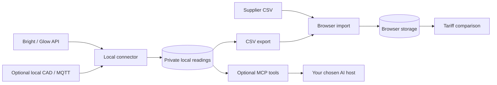

# Energy Lens

A cheap overnight rate does not always mean a cheaper electricity bill. Energy Lens compares the whole household: daytime use, standing charges and EV charging, using your half-hourly readings or an editable annual simulation.

**[Open Energy Lens](https://energylens.hammantlabs.com)** · **[Get and import your data](https://energylens.hammantlabs.com/guide.html)** · [Local connector / MCP tools](connector/README.md)

The dashboard is a static website hosted on GitHub Pages. No account is needed. Imported files and settings stay in your browser; there is no readings-upload endpoint or analytics. The optional connector runs on your computer to download Bright/Glow history, export CSVs, serve MCP tools and collect local CAD readings over MQTT.

## Get started

1. Open the [dashboard](https://energylens.hammantlabs.com). Try an annual simulation using the electricity kWh from your bill and your home EV charging, if any. The initial numbers are examples.
2. For a measured comparison, follow the [data guide](https://energylens.hammantlabs.com/guide.html): download half-hourly electricity consumption from EDF or use the Bright/Glow connector.
3. Choose **Import your data**, match the timestamp and kWh columns, then check the dates and missing intervals under **Data & method**.
4. Edit **Rates** to match your current regional quotes. Bundled London prices were checked on **17 October 2026**; some offers may have ended. They are comparison benchmarks, not live quotes.
5. Download a private JSON backup before changing browsers, devices or site addresses. Each CSV import replaces the current readings.

Use half-hourly **consumption in kWh**, not cumulative meter registers, prices or gas volume. EV kWh is optional and must be a subset of household use. A minimal synthetic example:

```csv
interval_start,consumption_kwh
2026-09-01T00:00:00+01:00,0.40
2026-09-01T00:30:00+01:00,0.35
```

The importer maps columns and supports explicit UTC or Europe/London interpretation. Ambiguous clock-change times require an offset. Rows explicitly marked missing, unavailable or null in a quality/status column are skipped; genuine zero readings remain. A complete UK day has 48 intervals, or 46/50 on clock-change days. Missing intervals are never filled with invented consumption.

## Download Glow data locally

Install Git and Node.js 22.13 or newer, then run:

```bash
git clone https://github.com/jhammant/energy-lens.git
cd energy-lens
npm --prefix connector ci
npm --prefix connector run build
node connector/build/cli.mjs login
node connector/build/cli.mjs meters
node connector/build/cli.mjs sync
node connector/build/cli.mjs export --out readings.csv
```

First finish meter verification and consent in Bright/Glow. The cloud route needs no CAD. `login` verifies credentials and saves them in your OS credential store; the website never receives them. Sync requests roughly 13 months by default, subject to available meter history. The [connector README](connector/README.md) covers date ranges, multiple meters, headless credentials, CSV import/export, MCP and MQTT.

## Run and verify

The website has no third-party browser dependencies. Node.js 22.13+ is required for the connector and tests; Python 3 serves the local preview.

```bash
npm --prefix connector ci
npm test
npm --prefix connector run lint
npm start
```

Open [localhost:18766](http://127.0.0.1:18766). For website-only development, `node scripts/build-core.mjs` copies shared calculation code into `dist/`; `node --test tests/*.test.mjs` runs the dashboard tests.

The complete tests cover energy conservation, charge windows and capacity, missing data, both daylight-saving transitions, CSV round trips, historical VAT rounding, dated tariffs, retries/resumed downloads, real MCP client/server traffic and a local MQTT broker. Provider tests use synthetic data and a test server, without a real household account.

## How it fits together



`core/` holds shared calculations and the dated tariff snapshot. `dist/` contains the static dashboard and data guide. `scripts/build-core.mjs` generates `dist/engine.mjs` and `dist/tariffs.mjs`; edit their source files in `core/`. `connector/` contains the separately built CLI, MCP server and MQTT collector.

## Privacy and scope

Household bills, addresses, account identifiers, credentials and real meter readings are not included in the source or website. Examples and automated tests are synthetic. Browser storage is local to each browser and site address and can be cleared. Downloaded backups contain the data you imported, so keep them private. GitHub Pages receives ordinary website requests when serving the app.

The connector stores readings in `~/.energy-lens/` with private file permissions on Unix. Its normal login uses the OS keychain. Connecting MCP tools makes returned readings visible to your chosen AI host. See the [connector documentation](connector/README.md#give-an-llm-access) before enabling that integration.

## Calculation and limits

- Annual mode uses a synthetic average day, preserving annual household and EV consumption. Non-EV night use is spread across 23:00–06:00; other use is spread over the remaining hours. This is an assumption, not a measured load profile.
- EV charging can move within an overnight plug-in window, capped by charger power. Measured rescheduling requires an EV column. Energy that cannot fit remains at its original time.
- Measured mode prices imported half-hours in UK local time. Standing charges cover calendar days between the first and last reading, including gaps. A partial result is not a complete bill.
- Comparisons replay selected prices against usage. They do not assert that those tariffs were available historically. The connector supports separate dated rates for historical bill reconstruction.
- EV-only discounts apply only to EV energy. Incomplete household quotes are not ranked.
- Gas, solar export, batteries, incentives, future exit costs, future variable-rate changes and extra smart-dispatch windows are outside the model. Confirm eligibility and a personal quote before switching.

Energy Lens is independent of EDF, Hildebrand and the suppliers shown.

## Deployment and contributing

Pushing `main` runs the tests and lint checks, then publishes only `dist/` through [GitHub Pages Actions](.github/workflows/pages.yml). The custom domain is `energylens.hammantlabs.com`. A separate [connector workflow](.github/workflows/connector.yml) checks Node 22/24 across Linux, macOS and Windows and builds downloadable artifacts. See [CONTRIBUTING.md](CONTRIBUTING.md) for development and deployment instructions.

The connector is available as source and buildable packages. It has not been published to npm or the MCP Registry; do not assume an `npx` install is available.

## Licence

[MIT](LICENSE) — Copyright © 2026 Jon Hammant.
