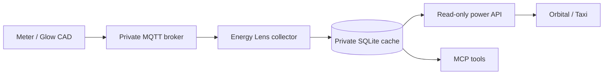

# Live power in Taxi / Orbital

This project describes Energy Lens's private, read-only power API with semantic
Taxi types. Orbital can discover the latest reading over HTTP while MCP continues
to use the same local SQLite cache. The public GitHub Pages site stays static.

## Data source

Live power needs compatible hardware. A
[Glow Display / CAD](https://shop.glowmarkt.com/products/display-and-cad-combined-for-smart-meter-customers)
can provide electricity measurements about every ten seconds through local MQTT.
A Bright/Glow account without a CAD provides delayed half-hourly history, not
instantaneous power. The collector currently accepts Glow's local CAD JSON format;
other devices need an adapter for their payload and units.



The API reads the cache on each request. It does not poll Glow or infer current
power from half-hour energy readings. Keep both processes below running, with
the same `--data-dir` if you override the default.

## Run the collector and API

Build the connector first (`npm ci && npm run build` from `connector/`). In one
terminal, replace the broker and device topic with your actual local settings:

```bash
node build/cli.mjs collect --broker mqtt://192.168.1.20:1883 --topic glow/DEVICE/SENSOR/electricitymeter --stream mqtt:home
```

In a second terminal:

```bash
node build/cli.mjs api --stream mqtt:home
```

The default listener is `127.0.0.1:18767`. Test it from the same machine:

```bash
curl --fail http://127.0.0.1:18767/v1/power
```

The result includes `streamId`, `observedAt`, `ageSeconds`, `status`, `powerWatts`,
`lastObservedPowerWatts` and `cumulativeImportKwh`. Watts describe instantaneous
power; kWh describe accumulated energy. The stream ID is a local label, not an
MPAN or account number. Use a non-sensitive label if sharing query results.

| Status        | Meaning                                   | `powerWatts`                           |
| ------------- | ----------------------------------------- | -------------------------------------- |
| `live`        | Latest sample is at most 60 seconds old   | Measured value, including genuine zero |
| `stale`       | Sample is older than the threshold        | `null`                                 |
| `unavailable` | No sample exists for the selected stream  | `null`                                 |
| `clock_skew`  | Sample is over five seconds in the future | `null`                                 |

`lastObservedPowerWatts` and its timestamp remain available after the feed stops.
Age is rounded to seconds and can be negative when clocks differ. Configure
freshness using `--stale-after SECONDS` (1–3600; default 60). A live status means a
recent measurement, not a guarantee that the MQTT connection remains open.

## Connect Orbital

1. Add this Taxi project to your private Orbital workspace, or copy `src/power.taxi`
   into an existing project.
2. Set the `energy-lens` URL in `orbital/config/services.conf` to the API address
   reachable **from Orbital**. Inside Docker, loopback refers to that container.
   Use a private tunnel or an authenticated listener on the collector's private
   interface. When copying files into another Taxi project, preserve the
   `additionalSources` entry from `taxi.conf` so Orbital loads the configuration.
3. Run the query in `current-power.taxiql`. It pins the source operation to avoid
   unnecessary discovery through unrelated services.

```taxiql
find { hammant.energylens.PowerSnapshot }
using { hammant.energylens.PowerApi::getPower }
```

This is a snapshot query: run it again to get the latest measurement. A client
refreshing every ten seconds provides a near-real-time display. Avoid query-result
caching; the API sends `Cache-Control: no-store`. This integration does not add a
live panel to the public dashboard or upload data from your browser.

### Private network access

The API refuses a non-loopback `--host` unless `ENERGY_LENS_API_TOKEN` contains a
32–512 character token without whitespace. Supply a randomly generated token
through your service environment or secret manager, not a CLI argument or Git.
Use a VPN, SSH tunnel or TLS reverse proxy when crossing machines; the built-in
listener serves HTTP. Tokens restrict access but do not encrypt network traffic.

For example, after providing the token in the collector service's environment:

```bash
node build/cli.mjs api --host 0.0.0.0 --port 18767 --stream mqtt:home
```

Copy `orbital/config/auth.conf.example` to `auth.conf` and supply the same
`ENERGY_LENS_API_TOKEN` in Orbital's environment. Orbital sends it as an
`Authorization: Bearer` header. Keep the URL private; publishing the source code
does not require publishing household telemetry. The API has no write/import
routes, no CORS access, and serves only the configured stream.

See Orbital's official [HTTP source documentation](https://orbitalhq.com/docs/describing-data-sources/http/)
and [upstream authentication guide](https://orbitalhq.com/docs/describing-data-sources/authentication-to-services/).

## Continuous event streams

For an Orbital `stream` query that reacts to each sample without repeated HTTP
queries, the documented route is to bridge normalized MQTT readings to Kafka
and declare a typed Kafka source. Orbital can then enrich each event with tariff
or other data and publish the results through SSE or WebSockets. See its
[streaming guide](https://orbitalhq.com/docs/querying/streaming-data/)
and [publishing queries guide](https://orbitalhq.com/docs/querying/queries-as-endpoints).

That Kafka bridge is not included here. The HTTP operation in this project is
not a streaming source: changing `find` to `stream`, or requesting SSE output
from Orbital, does not make it subscribe to MQTT. A push integration should emit
staleness/disconnection events as well as readings, so consumers do not retain a
last-known wattage as if it were current.

## Verification

Connector tests use a real local MQTT broker, independent SQLite connections and
HTTP requests to verify the complete collector-to-API path with synthetic data.
They also cover missing readings, real zero, stale and future readings, token
checks, rejected writes and browser-origin protection. The Taxi schema and query
were validated in Orbital Playground with synthetic live, stale and unavailable
responses. These checks do not prove that a
particular home's CAD is paired, that a live broker is configured, or that an
Orbital deployment can reach the API; check those when installing it.
